<picture>
  <source media="(prefers-color-scheme: dark)" srcset="dark_mode.svg" />
  <source media="(prefers-color-scheme: light)" srcset="light_mode.svg" />
  
</picture>

 

# Yahia Bin Zaman

**Software Engineer · Applied AI · Creative Technologist**

*Building useful software at the intersection of engineering, design and automation.*

---

### A little about me

I connect **software engineering, AI-powered automation and visual design** to create tools people enjoy using. Alongside building web and macOS applications, I bring **8+ years of experience** in graphic design, print production and creative operations at **Colorlab**.

- 🖥️ **Engineering:** Full-stack web apps, desktop utilities and practical AI workflows.
- 🎨 **Design:** Brand identities, typography, Adobe workflows and production-ready visuals.
- ⚙️ **Focus:** Removing repetitive work through thoughtful tools and automation.
- 📍 **Based in:** Bangladesh.

### Selected work

<table>
<tr>
<td width="50%" valign="top">

**[Borno Keyboard](https://github.com/yahiabinzaman/borno-keyboard)**

A Bengali typing experience for macOS, built around creative and everyday workflows.

`macOS` `Bangla Typography` `Input Tools`

</td>
<td width="50%" valign="top">

**[DisplayFlow](https://github.com/yahiabinzaman/DisplayFlow)**

A display-management utility designed for a more seamless Mac workspace.

`macOS` `Desktop Utility` `Productivity`

</td>
</tr>
<tr>
<td width="50%" valign="top">

**[VectorGuard PDF Pro](https://github.com/yahiabinzaman/VectorGuard-PDF-Pro)**

Tools for working with vector and PDF-focused design workflows.

`PDF` `Vector` `Creative Tools`

</td>
<td width="50%" valign="top">

**[Teamworks.io](https://github.com/yahiabinzaman/Teamworks.io)**

A software project exploring collaborative workflows.

`Web App` `Collaboration` `Workflow`

</td>
</tr>
</table>

<b>More things I've been building</b>

 

- **ColorLab Workspace** — Production, costing and operations software for print workflows.
- **Vector Toolkit Pro** — Automation utilities for Adobe Illustrator and prepress tasks.
- **[Clean Mac](https://github.com/yahiabinzaman/Clean-Mac)** — A Mac-focused utility project.
- **[Unicode Converter by Yaza](https://github.com/yahiabinzaman/Unicode-Converter-by-Yaza)** — Text conversion tooling.
- **[Smart Clipboard Form Filler](https://github.com/yahiabinzaman/smart-clipboard-form-filler)** — Clipboard and form workflow automation.

*Some projects are private or works in progress.*

### Tools & technologies

**Software & AI**

**Design & creative production**

### GitHub activity

---

### Let's make something thoughtful.

I'm interested in software, automation and design projects that solve real problems.

[**Email**](mailto:yahiamahmud10@gmail.com) · [**LinkedIn**](https://www.linkedin.com/in/yahia-mahmud-b4095b354/) · [**Behance**](https://www.behance.net/yahiamahmud) · [**GitHub**](https://github.com/yahiabinzaman)

Designed with intention · Built by Yahia Bin Zaman

